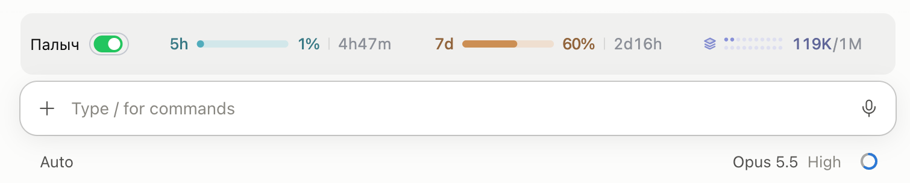

# Переключатель Палыча / Palych toggle



Мод для Claude Code: над полем ввода стоит панель. Первыми идут надпись
«Палыч» и переключатель, который включает и выключает режим в текущем
разговоре. В приложении это зелёная таблетка в стиле iOS в цветах темы
приложения; в терминале — кнопка `●` (вкл) или `○` (выкл). Дальше идут
показатели usage: 5h и 7d — доля лимита и время до сброса, ctx — сколько
токенов занято в окне контекста. На узкой панели показатели переносятся на
следующую строку, а переключатель остаётся на месте.

A Claude Code mod: a band sits above the prompt. The label «Палыч» and a
switch come first and turn the mode on or off for the current conversation.
The desktop app draws an iOS-style pill in the app theme's colours; the
terminal draws a `●` (on) or `○` (off) button. Usage figures follow: 5h and
7d show the share of the limit used and the time until it resets, ctx the
tokens used in the context window. On a narrow band the figures wrap to the
next line; the switch stays put.

`/palych-tab` скрывает панель, повторный вызов возвращает её; скрытие
действует до конца сессии. / `/palych-tab` hides the band and running it
again brings it back; hiding lasts until the session ends.

## Установка / Install

Установка Палыча для Claude Code по [INSTALL.md](../../INSTALL.md) ставит мод
вместе с общими инструкциями. Вручную / By hand:

```sh
claude plugin marketplace add ponomr/palych
claude plugin install palych-toggle@palych
```

Удаление / Remove: `claude plugin uninstall palych-toggle@palych`.

## Как работает / How it works

Мод рассчитан на установку Палыча через общие инструкции
(`scripts/install.py install --host claude-code`). Он не меняет файлы и
настройки. Пока переключатель выключен, к каждому сообщению пользователя
добавляется скрытая для пользователя пометка: Палыч выключен, это явная
просьба пользователя. Правила Палыча уже требуют исполнять такую просьбу.
После включения следующее сообщение один раз получает пометку о включении.

The mod targets the global-instructions installation. It edits no files or
settings. While the switch is off, every user message carries a note the user
does not see: Palych is off at the user's explicit request, which Palych's
rules already honour. Switching it back on adds a one-time note to the next
message.

Фразы управления из `adapters/README.md`, отправленные отдельным сообщением
(«Отключи Палыча», “Turn off palych”), двигают переключатель тоже.

The control phrases from `adapters/README.md`, sent as a whole message, move
the switch too.

Переключатель и определение темы взяты из переключателя auto compact мода
usage-quota (MIT, © 2026 Anant Raghunath). Чтобы узнать тему, мод раз в 2 с
проверяет `userThemeMode` в настройках приложения Claude
(`~/Library/Application Support/Claude/config.json` или
`%APPDATA%/Claude/config.json`), а для «system» спрашивает ОС
(`defaults read -g AppleInterfaceStyle` или реестр Windows).

The switch and the theme detection come from the usage-quota mod's auto
compact switch (MIT, © 2026 Anant Raghunath). To learn the theme, the mod
checks `userThemeMode` in the Claude app's settings every 2 s and, for
"system", asks the OS.

Рисунок показателей перенесён из
[usage-band](https://github.com/JetsonChan/CC-Usage-Band) (коммит 60cd609,
MIT, © 2026 Jetson Chan) без анимации полосок и доли попаданий в кэш.
Обновление показателей сделано по образцу
[usage-line](https://github.com/sundyme/usage-line) (коммит 194c8f7, MIT,
© 2026 sundyme).

The figures' drawing is ported from usage-band (commit 60cd609, MIT, © 2026
Jetson Chan) without its bar animation and cache-hit figure. Keeping the
figures current follows usage-line (commit 194c8f7, MIT, © 2026 sundyme).

## Ограничения / Limits

- Новый разговор начинается с «Палыч вкл»; состояние не сохраняется между
  разговорами. / A new conversation starts on; the state is per conversation.
- Другие формулировки выключения модель поймёт, но переключатель о них не
  узнает. / Other wording reaches the model but does not move the switch.
- Пометка — инструкция модели, а не удаление правил из контекста. В живой
  сессии приложения видно, что пометка доходит до модели; стиль ответов
  систематически не оценивался. / The note is an instruction to the model, not
  removal of the rules from context. A live desktop session shows the note
  reaching the model; reply style was not evaluated systematically.
- Нажатие срабатывает только там, где приложение рисует подпись кнопки,
  поэтому подпись невидимой кнопки — три широких пробела поверх таблетки. /
  The app presses a button only where its label is drawn, so the invisible
  button's label is three em spaces laid over the pill.
- Показатели появляются, когда Claude Code сообщает о лимитах и контексте;
  до этого на панели только переключатель. / The figures appear once Claude
  Code reports limits and context; until then the band holds only the switch.
- Не для плагина `palych@palych`: у плагина своё сохранённое состояние, и
  при сохранённом выключении правила в новую сессию не попадают, а
  переключатель показывает «вкл». / Not for the `palych@palych` plugin: it keeps
  its own saved state, and with "always off" saved the rules never reach a new
  session while the switch shows on.

## Проверка / Checks

```sh
claude plugin validate mods/palych-toggle
claude plugin test mods/palych-toggle
```

Для пробного запуска / To try it in one session:

```sh
claude --plugin-dir mods/palych-toggle
```
